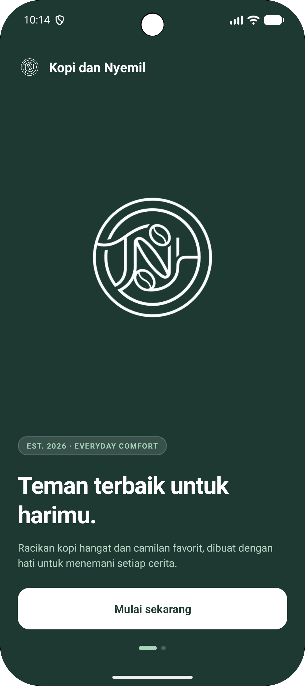
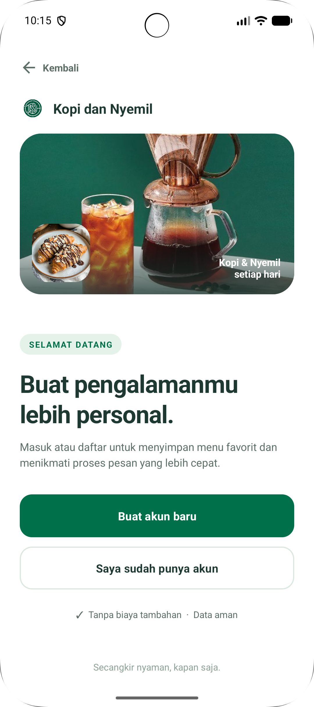
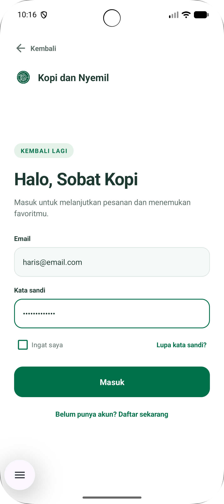
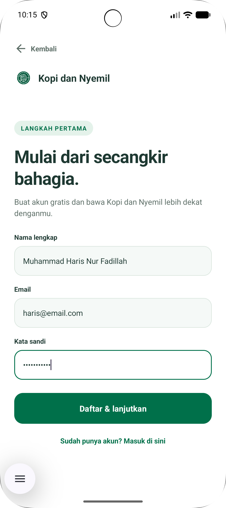
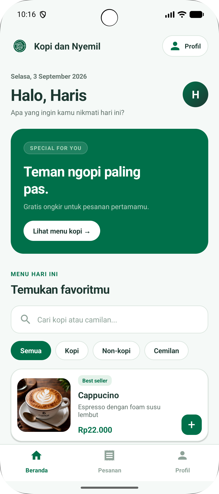
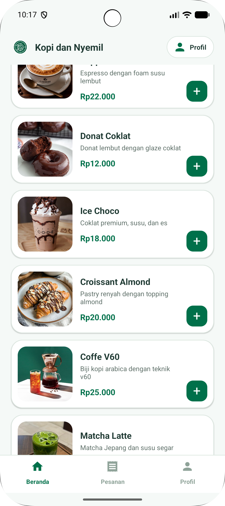
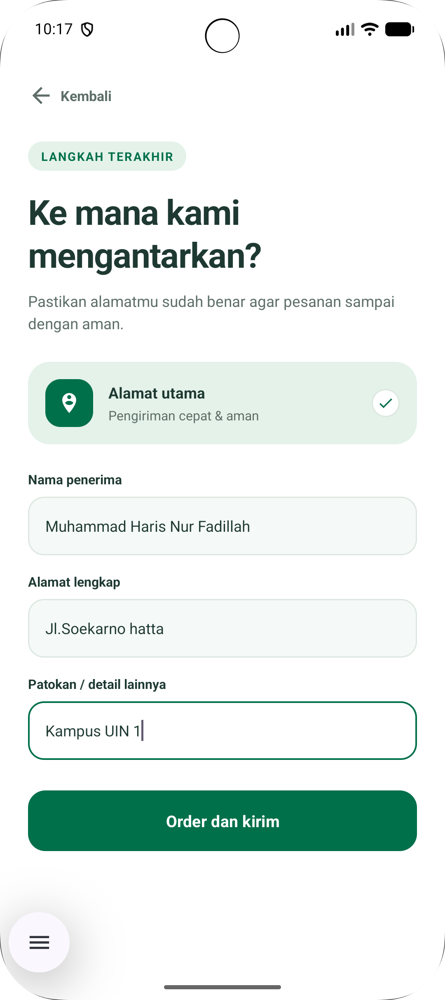
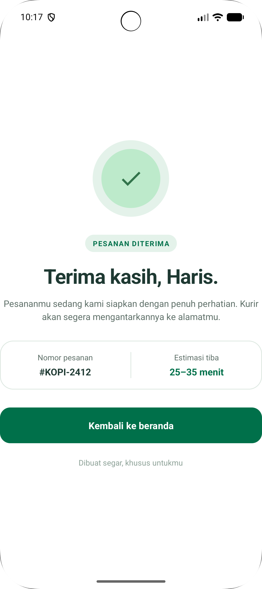
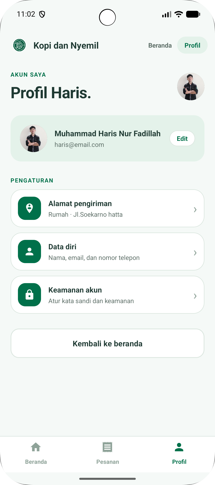
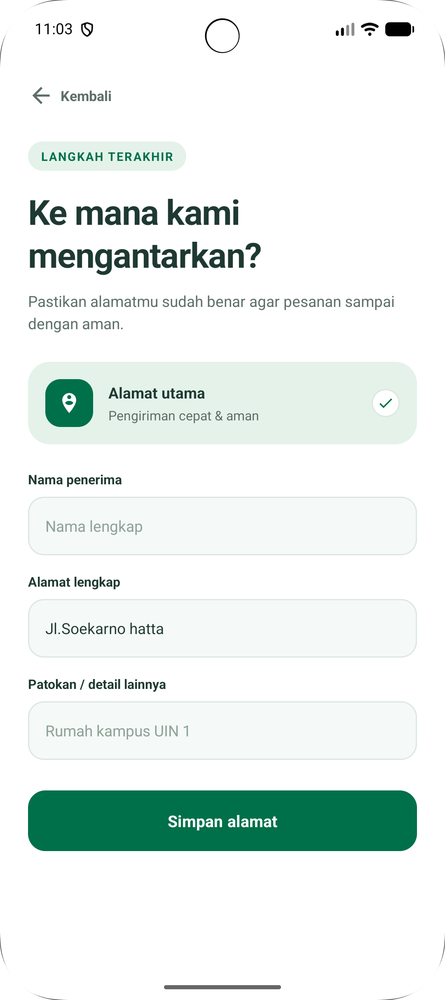

# Kopi dan Nyemil

**Kopi dan Nyemil** adalah aplikasi Android untuk memesan kopi, minuman non-kopi, dan camilan. Pengguna bisa melihat daftar menu terus mencari dan memfilter berdasarkan kategori, menambahkan menu ke keranjang, mengisi alamat pengiriman, lalu menerima konfirmasi pesanan.

Proyek ini dibuat sebagai tugas **UTS PAM** (`lat.pam.utspam_haris`).

---

## Deskripsi Aplikasi

Aplikasi ini mensimulasikan alur pemesanan di kedai kopi dari awal sampai akhir: mulai dari layar sambutan, daftar atau masuk akun, memilih menu, mengisi alamat, sampai halaman konfirmasi pesanan. Tampilannya memakai palet warna hijau (`#00704A` dan `#1E3932`) dengan komponen Material Design 3.

### Alur Aplikasi

```
Welcome ──► Signup ──┬──► Login ────┐
                     └──► Register ─┴──► Home ──┬──► Profil ──► Alamat (simpan)
                                                └──► Alamat (pesan) ──► Konfirmasi ──► Home
```

---

## Fitur

| Fitur | Keterangan |
|---|---|
| **Welcome screen** | Layar pembuka bertema gelap dengan logo dan tombol "Mulai sekarang". |
| **Signup, Login, dan Register** | Tiga halaman autentikasi dengan desain konsisten dan bisa di-scroll di layar kecil. |
| **Daftar menu** | 6 menu: Cappucino, Donat Coklat, Ice Choco, Croissant Almond, Coffe V60, dan Matcha Latte. Setiap menu punya foto, deskripsi, harga, dan tag (misalnya *Best seller*). |
| **Filter kategori** | Chip **Semua / Kopi / Non-kopi / Cemilan**, dan banner promo yang langsung membuka kategori Kopi. |
| **Pencarian menu** | Mencari menu berdasarkan nama secara langsung saat mengetik. |
| **Keranjang** | Tombol **+** menambah jumlah pesanan. Tombol "Pesan sekarang (n)" muncul setelah ada item di keranjang. |
| **Alamat pengiriman** | Alamat disimpan di perangkat dan dipakai saat memesan maupun di halaman profil. |
| **Konfirmasi pesanan** | Halaman ringkasan berisi nomor pesanan dan estimasi tiba. |
| **Profil** | Menampilkan data akun dan menu pengaturan (alamat pengiriman, data diri, keamanan akun). |
| **Bottom navigation** | Perpindahan cepat antara Beranda, Pesanan, dan Profil. |

---

## Daftar Menu dan Harga

| No | Menu | Kategori | Deskripsi | Harga | Tag |
|:--:|---|---|---|--:|:--:|
| 1 | **Cappucino** | Kopi | Espresso dengan foam susu lembut | Rp22.000 | Best seller |
| 2 | **Donat Coklat** | Cemilan | Donat lembut dengan glaze coklat | Rp12.000 | - |
| 3 | **Ice Choco** | Non-kopi | Coklat premium, susu, dan es | Rp18.000 | - |
| 4 | **Croissant Almond** | Cemilan | Pastry renyah dengan topping almond | Rp20.000 | - |
| 5 | **Coffe V60** | Kopi | Biji kopi arabica dengan teknik v60 | Rp25.000 | - |
| 6 | **Matcha Latte** | Non-kopi | Matcha Jepang dan susu segar | Rp23.000 | - |

**Ringkasan per kategori**

| Kategori | Jumlah Menu | Kisaran Harga |
|---|:--:|---|
| Kopi | 2 | Rp22.000 - Rp25.000 |
| Non-kopi | 2 | Rp18.000 - Rp23.000 |
| Cemilan | 2 | Rp12.000 - Rp20.000 |

## Teknologi yang Digunakan

| Kategori | Detail |
|---|---|
| Bahasa | **Kotlin** (JVM target Java 11) |
| Platform | Android, `minSdk 27` (Android 8.1), `targetSdk 37`, `compileSdk 37` |
| UI | XML layout, **Material Components 3** (`Theme.Material3.DayNight.NoActionBar`) |
| Library | AndroidX AppCompat, Core KTX, Activity KTX, ConstraintLayout, Material |
| Penyimpanan lokal | `SharedPreferences` (lewat objek `AppStorage`) |
| Build system | Gradle (Kotlin DSL) dengan version catalog |
| Testing | JUnit, AndroidX Test, Espresso (template bawaan) |

---

### Versi library

| Library | Versi |
|---|---|
| `androidx.core:core-ktx` | 1.19.1 |
| `androidx.appcompat:appcompat` | 1.8.0 |
| `androidx.activity:activity-ktx` | 1.13.0 |
| `androidx.constraintlayout:constraintlayout` | 2.2.2 |
| `com.google.android.material:material` | 1.14.0 |


## Struktur Proyek

```
app/src/main/
├── java/lat/pam/utspam_haris/
│   ├── MainActivity.kt          # Pintu masuk, langsung membuka Welcome
│   ├── WelcomeActivity.kt       # Layar sambutan
│   ├── SignupActivity.kt        # Pilihan daftar atau masuk
│   ├── LoginActivity.kt         # Form masuk
│   ├── RegisterActivity.kt      # Form daftar
│   ├── HomeActivity.kt          # Daftar menu, filter, pencarian, keranjang
│   ├── ProfileActivity.kt       # Profil dan pengaturan
│   ├── AddressActivity.kt       # Alamat pengiriman (mode pesan atau simpan)
│   ├── ConfirmationActivity.kt  # Konfirmasi pesanan
│   ├── MenuItemData.kt          # Model data menu
│   └── AppStorage.kt            # Wrapper SharedPreferences
├── res/
│   ├── layout/                  # activity_*.xml dan item_*.xml
│   ├── drawable/                # ikon, background, dan foto menu
│   └── values/                  # strings, colors, styles, themes
└── AndroidManifest.xml
```

---

## Cara Menjalankan Aplikasi

### Prasyarat

- **Android Studio** versi terbaru yang mendukung Android SDK Platform 37
- **JDK 11** atau lebih baru (sudah termasuk di Android Studio)
- Emulator Android (API 27 ke atas) atau perangkat fisik dengan USB debugging aktif

### Langkah-langkah

1. **Clone repositori**
   ```bash
   git clone https://github.com/Harisnoresst/utsPAM_1247050090_Haris.git
   cd utsPAM_Haris
   ```
2. **Buka di Android Studio**: pilih **File → Open**, lalu arahkan ke folder proyek.
3. **Tunggu Gradle sync** sampai selesai. Jika diminta, install **Android SDK Platform 37** lewat *SDK Manager*.
4. **Pilih perangkat**: buat emulator lewat *Device Manager*, atau sambungkan HP.
5. **Jalankan** dengan menekan tombol ▶ **Run 'app'** (`Shift + F10`).

### Lewat command line (opsional)

```bash
./gradlew assembleDebug      # build APK debug
./gradlew installDebug       # build dan pasang ke perangkat/emulator yang tersambung
```

APK hasil build ada di `app/build/outputs/apk/debug/`.

### Menjalankan test

```bash
./gradlew test                    # unit test
./gradlew connectedAndroidTest    # instrumented test (butuh emulator/perangkat)
```

---

## Screenshot

> Simpan gambar di folder `docs/screenshots/` dengan nama file seperti di tabel di bawah, maka gambar akan tampil otomatis.

|                            Welcome                            |                           Signup                            |                           Login                           |
|:-------------------------------------------------------------:|:-----------------------------------------------------------:|:---------------------------------------------------------:|
|  |  |  |

|                            Register                             |                          Home                           |                           Home2                            |
|:---------------------------------------------------------------:|:-------------------------------------------------------:|:----------------------------------------------------------:|
|  |  |  |

|                           Alamat                            |                             Konfirmasi                              |                            Profil                             |
|:-----------------------------------------------------------:|:-------------------------------------------------------------------:|:-------------------------------------------------------------:|
|  |  |  |


|                             Edit Alamat                             | 
|:-------------------------------------------------------------------:|
|  |

---

### Ide pengembangan

- Autentikasi sungguhan (Firebase Auth atau REST API) dan validasi form
- Keranjang lengkap dengan jumlah per item dan total harga
- Menu dari database (Room) atau API
- Riwayat pesanan pada tab "Pesanan"
- Migrasi ke Jetpack Compose atau View Binding

---

## developer

**Muhammad Haris Nur Fadillah 1247050090**

---
